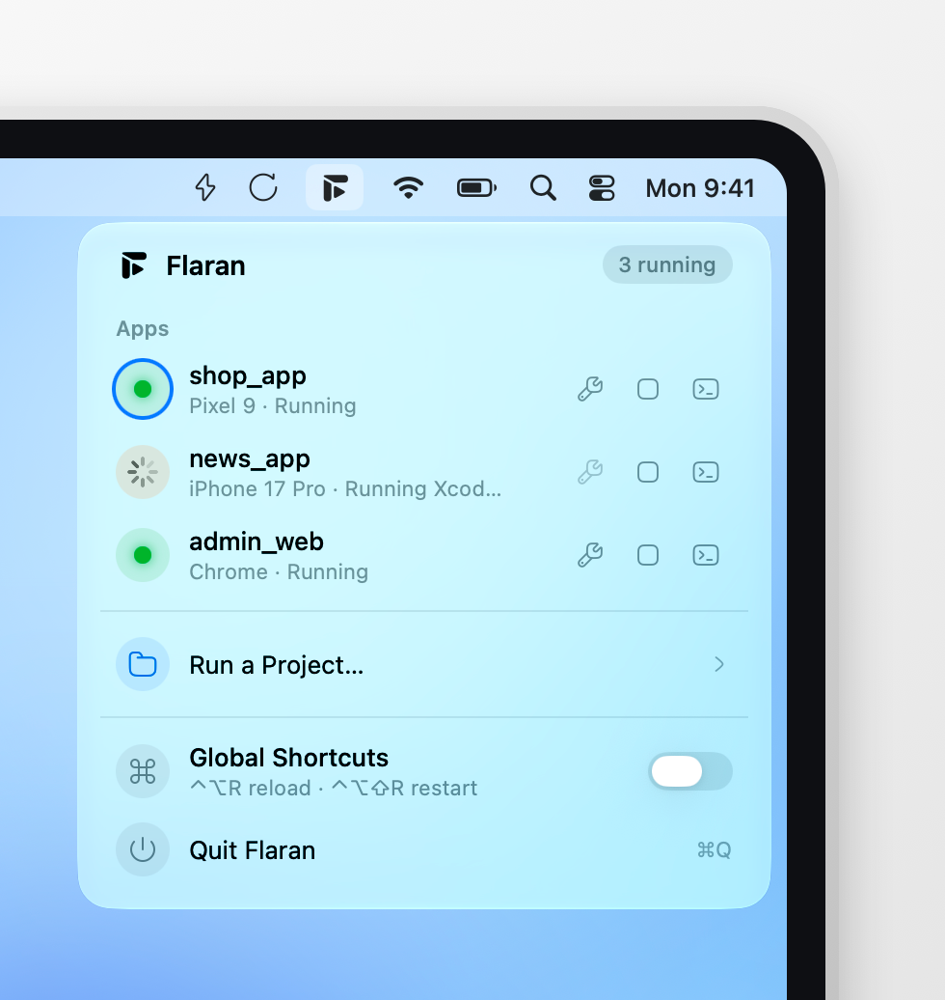
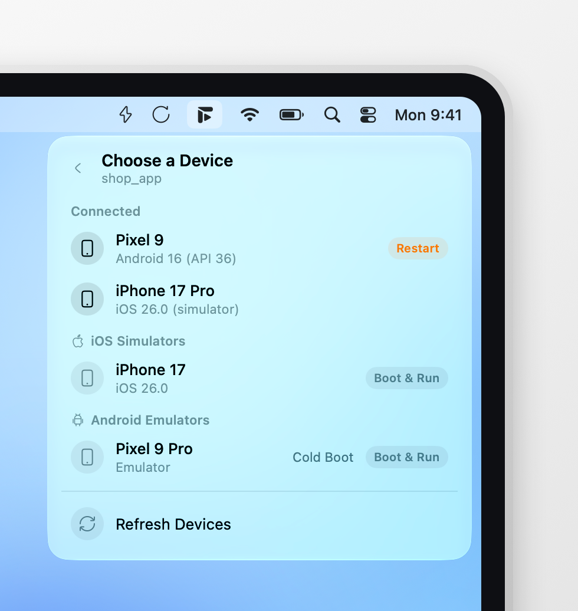

<h1 align="center">
  <br>
  Flaran
</h1>
<p align="center">Run, hot reload and restart your Flutter apps from the macOS menu bar.</p>

## Why I built this

I code Flutter apps from the terminal now, in Warp or Orca, with Claude Code, OpenCode or Antigravity.

Checking the app myself used to break that flow. I either kept VS Code open just for its debug toolbar, or ran `flutter run` / `fvm flutter run` in another terminal and switched to it every time I needed logs or a restart.

Flaran keeps you in the flow. Start your app from the menu bar, then reload or restart with one click while you keep working in the terminal. Logs are there when you need them.

## A quick look

<p align="center">
  
  
</p>

## What it does

- **Reload and restart buttons in the menu bar.** They show up while an app is running. Clicking them doesn't steal focus from your terminal.
- **A run panel under the Flaran icon**, similar to the Wi-Fi menu. Pick a project, a launch configuration and a device.
- **Device picking like VS Code.** Connected devices, Android emulators and iOS simulators are listed by name. Pick one that's off and Flaran boots it, then runs your app on it. On Xcode 27 simulators open in Device Hub.
- **Several apps at once.** Run two projects, or the same project on iOS and Android, and choose which one the buttons act on.
- **Error dot and logs.** When your app throws, the icon gets a red dot. The log opens right in the panel, where you can filter errors and copy them.
- **DevTools** opens in your browser with one click.
- **Optional global shortcuts:** ⌃⌥R to reload and ⌃⌥⇧R to restart, from any app.

It reads your project the way VS Code does:

- `.vscode/launch.json`: `program`, `cwd`, `flutterMode`, `deviceId`, `toolArgs`, `args` and `env` (flavors and `--dart-define`s work)
- FVM: `.fvm/flutter_sdk`
- `dart.flutterSdkPath` in `.vscode/settings.json`
- otherwise, the `flutter` on your shell's `PATH`

If a project pins a Flutter version that isn't installed, Flaran tells you. It won't quietly use a different one.

## Install

You need macOS 26 or later and a working Flutter SDK.

1. Download `Flaran-x.y.z.dmg` from the [latest release](https://github.com/7ANV1R/Flaran/releases/latest).
2. Open it and drag Flaran into Applications.
3. Flaran isn't signed, so macOS blocks it the first time. Run this once in Terminal:

   ```sh
   xattr -dr com.apple.quarantine /Applications/Flaran.app
   ```

   Or without Terminal: open Flaran, dismiss the warning, then go to **System Settings > Privacy & Security** and click **Open Anyway**.
4. Open Flaran. The icon appears in the menu bar.

If you'd rather not run a downloaded binary, build it yourself. It takes about a minute.

## Build from source

You need Xcode 26 or later (Swift 6.2+).

```sh
git clone https://github.com/7ANV1R/Flaran.git
cd Flaran
make install    # builds Flaran.app and copies it to /Applications
```

Other targets:

```sh
make run          # build and open from build/
make test         # unit tests
make dmg          # build/Flaran-<version>.dmg
make dist         # the DMG plus a zip, for a release
make screenshots  # regenerate the README images
```

There's also an end-to-end test that runs a real Flutter macOS app:

```sh
FLARAN_FLUTTER_PROJECT=/path/to/flutter_app swift test --filter real
```

## Using it

1. Click the Flaran icon, then **Run a Project…** and **Open Folder…** to add your project.
2. Pick a launch configuration (if you have more than one) and a device. The run shows up right away with its progress: preparing, building, launching, running.
3. Reload and restart appear next to the icon. Each row in the panel also has DevTools, stop and logs.
4. Next time, the panel offers your last project and device as a one-click run.

## Project layout

```
Sources/FlaranKit   Flutter side: daemon protocol, sessions, devices, SDK and launch.json handling
Sources/Flaran      Menu bar UI: status items, the panel, logs, shortcuts
Tests               Swift Testing suites (RealFlutterTests is opt-in)
scripts             icons, logo, DMG and screenshot generators
assets              README screenshots
Resources           Info.plist, app icon, logo
```
